<p align="center">
  <picture>
    <source media="(prefers-color-scheme: dark)" srcset="branding/logo/assess-wordmark-dark.svg" />
    
  </picture>
</p>

<h1 align="center">Assess <code>ax</code></h1>

<p align="center">
  <b>Run exams in your classroom from one laptop.</b><br>
  Students answer from any browser. No installation, no accounts, no internet.
</p>

<p align="center">
  
  
  
  
  
</p>


> **Pre-alpha.** Rehearse with a practice exam before you use `ax` for a graded
> one.

- [Features](#features)
- [Example exams](#example-exams)
- [Teacher guide](#teacher-guide)
- [Creating an exam](#creating-an-exam)
- [The vault](#the-vault)
- [Settings and language](#settings-and-language)
- [Development](#development)
- [Brand](#brand)

## Features

### For the teacher

Everything is one program that needs no installation and no internet. Fonts,
math and the student app are inside it. It runs on Windows, Linux and macOS,
and can live on a USB stick (`ax portable init E:\ax --copy-vault`).

A live panel shows who is on which question, who has left the exam, and how
each student is doing. Closing the panel never stops the exam.

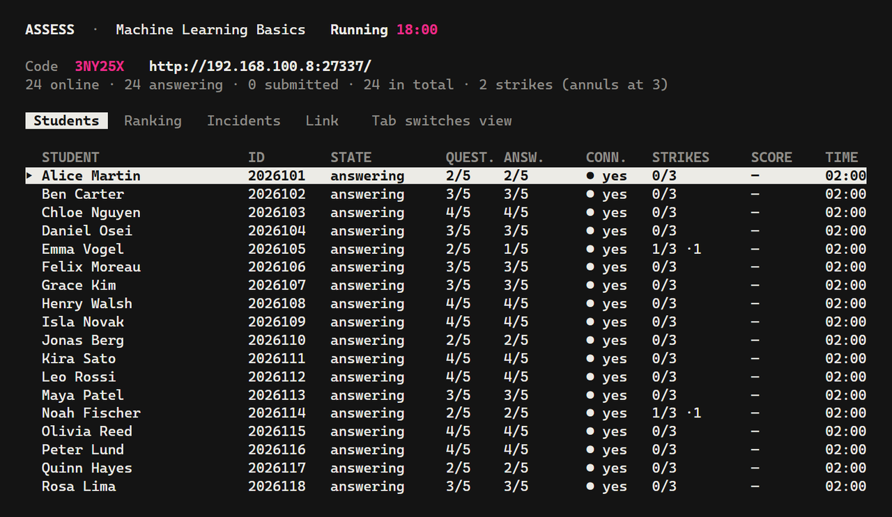

Students join with the link, the QR code or the session code. The Incidents
view lists what happened, and you can revert any penalty.

| Joining | Incidents |
|---|---|
| 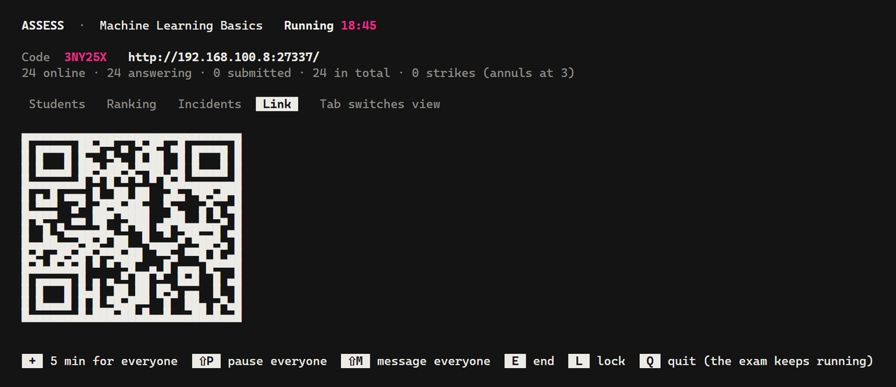 | 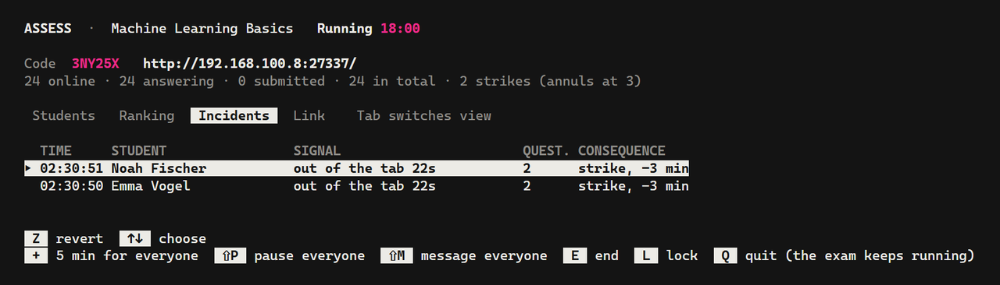 |

After the exam, `ax report` shows score and time charts, how each question
behaved, and the incident timeline. It also flags evidence worth a look:
similar wrong answers, correct answers right after leaving the exam, and
questions that may have leaked. Evidence is a prompt to review, not proof.

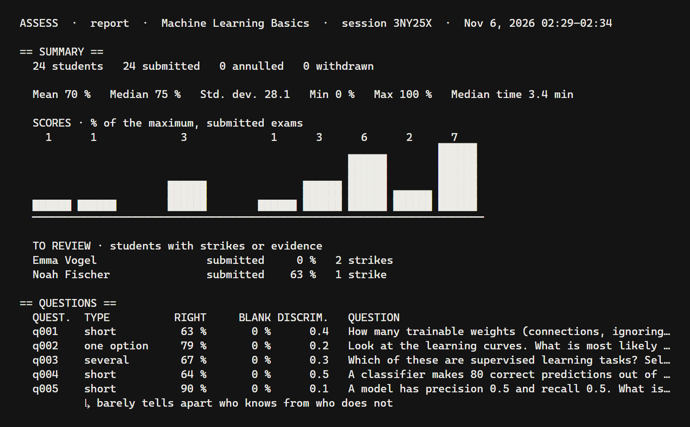

- **Grading:** single choice, multiple choice, true/false, and short number or
  text answers. Grades are automatic, and partial credit is optional.
- **Fair time:** the server keeps the clock, and you can give extra time to
  one student or to everyone.
- **Variation:** shuffled questions and options, and question pools that give
  each student a different question.
- **Classes:** import class lists from CSV, restrict an exam to one class, and
  keep a gradebook you can export to Excel.
- **Vault:** exams, classes and results are archived and searchable, with
  automatic backups. It can be encrypted. See [The vault](#the-vault).
- **Plain files:** an exam is a folder of YAML you can edit, copy and version.

### For the student

There is nothing to install. A phone, a laptop or a school PC is enough.

| Join | Read the rules | Answer |
|---|---|---|
| 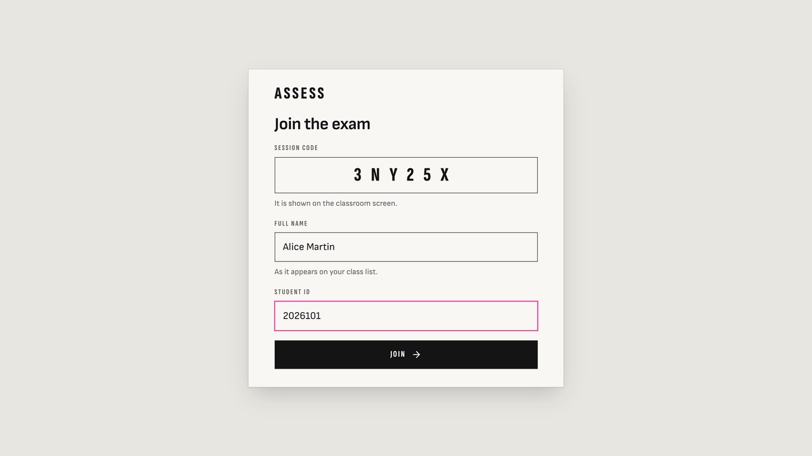 | 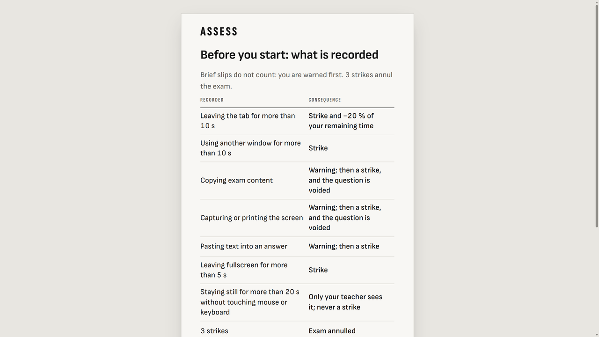 | 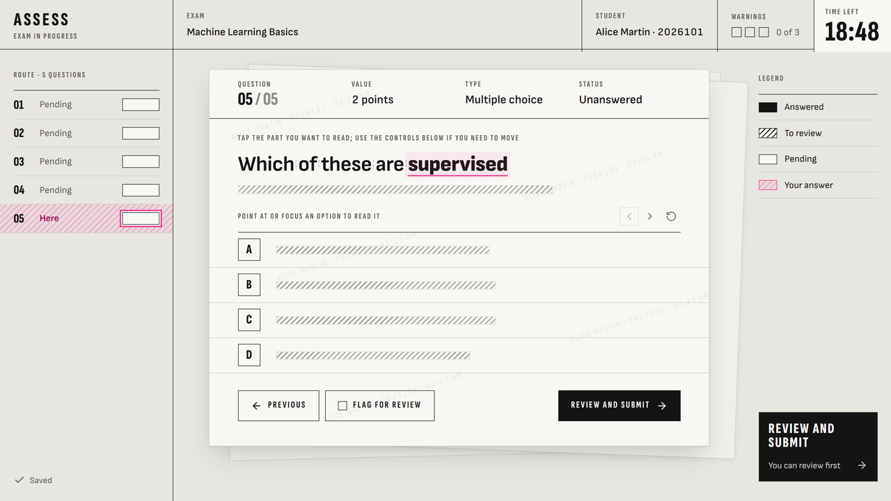 |

| Review | See the result | On a phone |
|---|---|---|
| 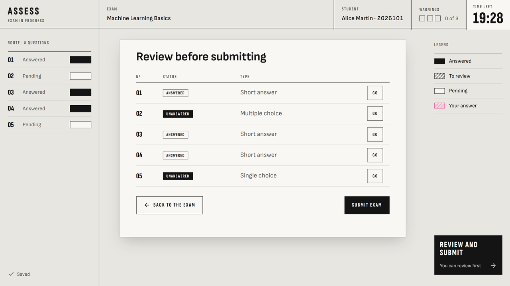 | 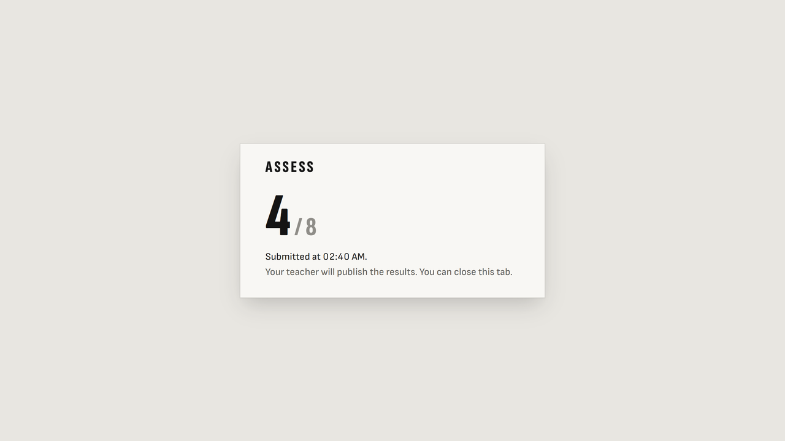 | 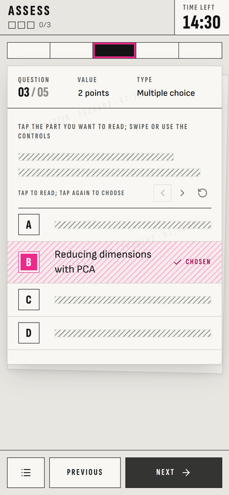 |

Answers save themselves, and they survive a Wi-Fi drop, a closed tab or a
server restart. Each exam decides whether students then see nothing, their
score, or a full review once the session closes.

### Fair anti-cheat, without spying

`ax` uses only what a browser can see. It uses no webcam, no lockdown browser
and nothing outside the exam tab. Students see every rule before they start,
and each penalty can be reverted.

| Profile | What it does |
|---|---|
| `off` | No protections. Good for practice. |
| `standard` | Warns first, then counts strikes. Three strikes annul the exam. |
| `strict` | Counts at once. The second strike annuls the exam. |

`standard` and `strict` can:

- show the prompt through a reading lens, a few words at a time, so a photo of
  the screen captures little;
- reveal options only under the pointer or on keyboard focus;
- hide the exam when it loses focus, and add a watermark with the student's name;
- block copy and paste, and require fullscreen.

You can tune each protection per exam, and set per-student accommodations from
the panel.

> **It has limits.** `ax` makes cheating harder and leaves a record, but it cannot
> detect a second device, and an AI can often answer from a photo of the prompt.
> Stay in the room for a graded exam.

[Anti-cheat methods and limits](docs/anti-cheat.md) lists every protection, what
is recorded, and what `ax` cannot do.

| Reading lens | Options revealed one at a time |
|---|---|
| 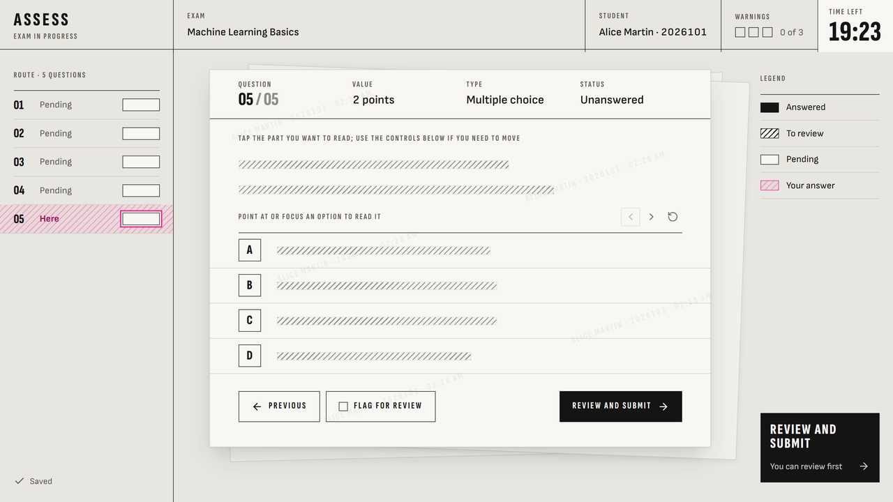 | 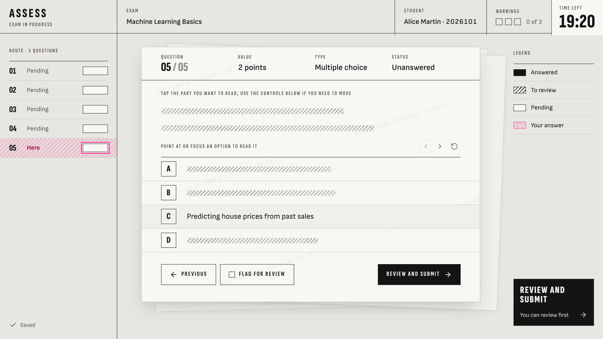 |

## Example exams

[`examples/`](examples) holds ready-made exams in Spanish and English. Try one:

```sh
ax start examples/algebra-01
```

### Real exams

Two examples use real questions from real institutions, with the source named
in each exam.

| Spanish: UNI admission, Physics | English: U.S. naturalization, civics |
|---|---|
| 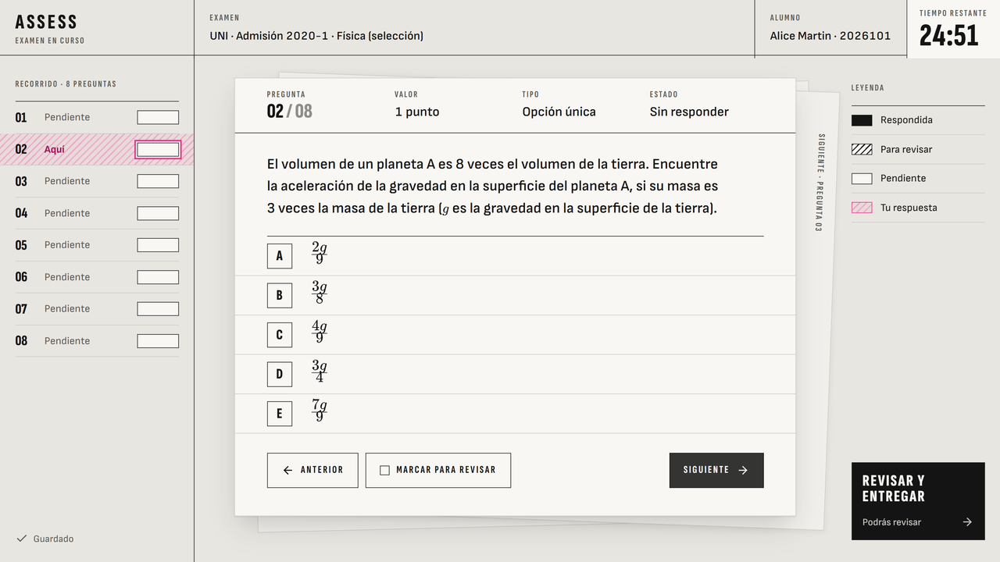 | 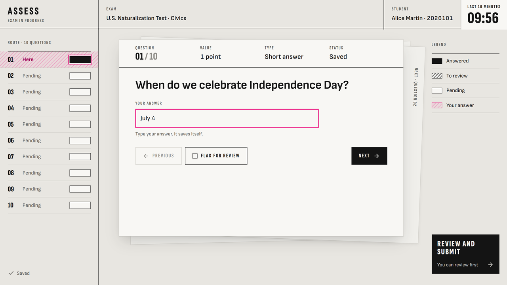 |
| [`uni-fisica-2020-1`](examples/uni-fisica-2020-1): 8 questions from the [official 2020-1 solutions booklet](https://admision.uni.edu.pe/wp-content/uploads/2022/11/solucionario2020.pdf) of the Universidad Nacional de Ingeniería (Peru) | [`uscis-civics`](examples/uscis-civics): each student gets 10 of 20 questions from the [official USCIS list](https://www.uscis.gov/sites/default/files/document/questions-and-answers/100q.pdf) |

The UNI questions remain the property of UNI. They are a short selection for
study.

### What exams can hold

| Math | Code | Diagrams |
|---|---|---|
| 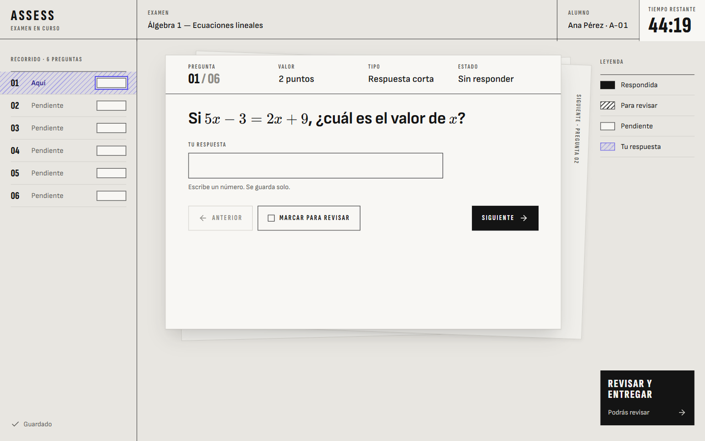 | 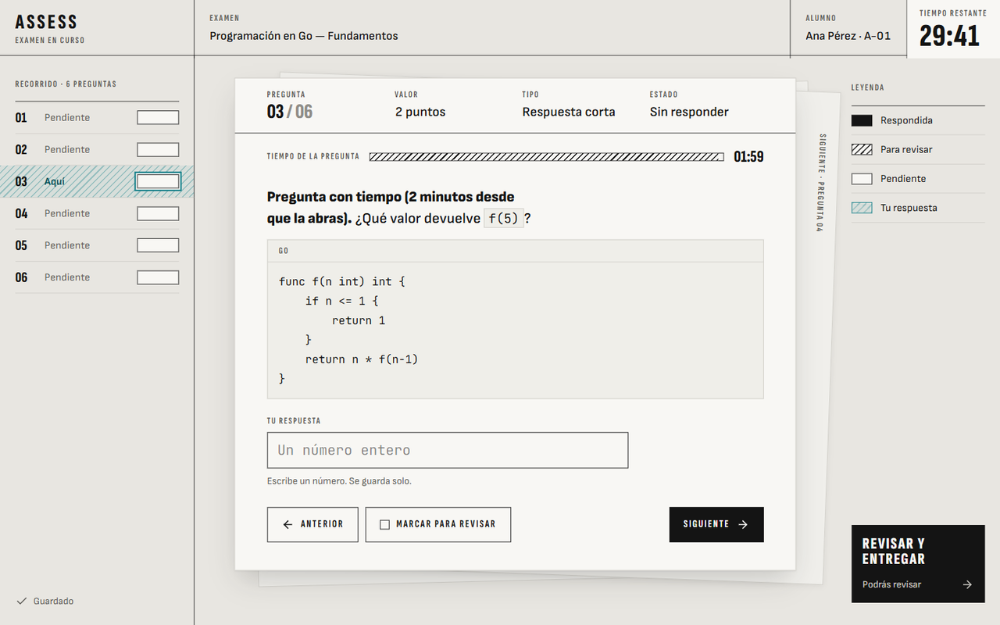 | 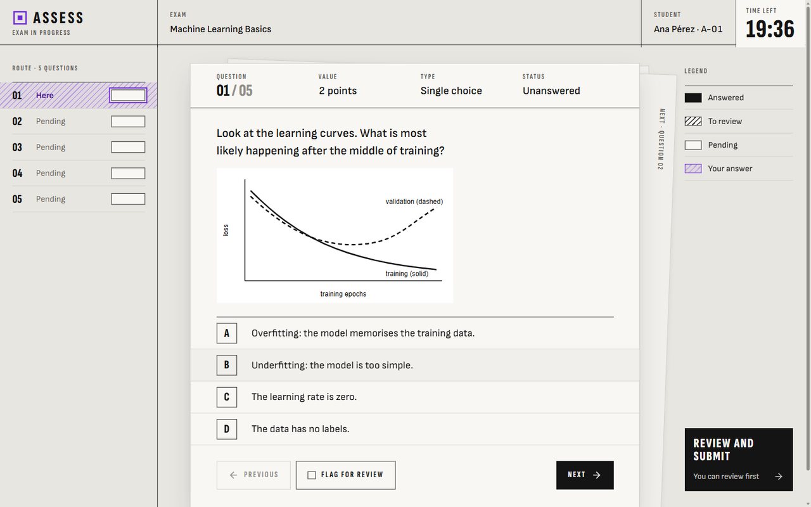 |
| [`algebra-01`](examples/algebra-01) | [`programacion-go`](examples/programacion-go) | [`ml-basics-en`](examples/ml-basics-en) |

The exams in these images ran with proctoring turned off, so the whole question
is visible.

| Exam | Language | Proctoring | Shows |
|---|---|---|---|
| [`algebra-01`](examples/algebra-01) | es | `standard` | Math, every question type, a pool, a 90-second question |
| [`programacion-go`](examples/programacion-go) | es | `strict` | Code blocks, required fullscreen, desktop only, review afterwards |
| [`ml-basics-en`](examples/ml-basics-en) | en | `standard` | English interface, SVG diagrams, logo and accent color |
| [`uni-fisica-2020-1`](examples/uni-fisica-2020-1) | es | `standard` | Real admission questions, formulas, fixed order, review afterwards |
| [`uscis-civics`](examples/uscis-civics) | en | `off` | Real test questions, a pool of 20, short text answers |
| [`quimica-secundaria`](examples/quimica-secundaria) | es | `standard` | Protections against photos of the screen |
| [`quiz-rapido`](examples/quiz-rapido) | es | `off` | Five minutes, no proctoring, hidden score |

[`examples/README.md`](examples/README.md) lists them all, with scenarios to
try: cheating, a crash, time running out.

## Teacher guide

### Before exam day

**1. Get `ax`.** It is one file, `ax.exe` on Windows and `ax` on Linux and
macOS. There is no published download yet, so build it once with
[Go](https://go.dev/dl/) and copy the file wherever you like:

```sh
go build ./cmd/ax
```

The commands below are written as `ax`. On Windows, run them as `.\ax.exe`
from the folder where the file is. For the interface in Spanish, run
`ax config set language es`. See [Settings and language](#settings-and-language).

**2. Check that students can reach your computer.** Do this on the network you
will use in class:

```sh
ax firewall
```

On Windows, `ax firewall setup` opens the port once per computer. It needs an
administrator's password, once. If you have none, `ax firewall script` writes a
file to hand to your IT staff. See [Classroom network](docs/classroom-network.md).

**3. Write the exam.** See [Creating an exam](#creating-an-exam), then check it.
Errors name the file, line and field:

```sh
ax validate my-exam
```

**4. Import your class (optional).** Save the list as CSV with an ID column and
a name column. The students then appear in the panel before they join.

```sh
ax class import 3B list-3B.csv
```

**5. Rehearse.** Run the exam once, with a phone as the student.

### During the exam

**1. Start the session:**

```sh
ax start my-exam                           # anyone with the code can join
ax start my-exam --class 3B                # lists the class in advance
ax start my-exam --class 3B --roster-only  # others wait for your approval
```

**2. Let students in.** Press **Tab** until you reach the **Link** view and put
it on the projector. Students open the link or scan the QR code, then enter the
code, their name and their ID. They wait in a lobby.

**3. Press S** when everyone is in. The clock starts for all of them. Latecomers
can join for 15 minutes after the start and get the remaining time.

**4. Supervise.** **Tab** switches between Students, Ranking, Incidents and
Link. **↑↓** selects a student.

| Key | Action |
|---|---|
| **T** | Extra time for the selected student |
| **+** | 5 extra minutes for everyone |
| **m** / **⇧M** | Message the student / everyone |
| **p** / **⇧P** | Pause or resume the student / everyone |
| **V** | Let the student read without the lens |
| **Z** | Revert a penalty, with a note |
| **X** / **U** | Annul / readmit the student |
| **N** / **D** | Add / remove a student |
| **A** / **R** | Approve / reject a device or student waiting for you |
| **G** | Approve a waiting student and add them to the class |
| **I** | Open the report, once the exam has ended |
| **L** | Lock the panel |
| **Q** | Leave the panel. The exam keeps running |
| **E** | End the exam |

**5. End the exam.** It ends by itself when everyone has submitted or time runs
out. To end it early press **E**, then **Y** to keep the server running or **A**
to stop it too. Every attempt is submitted with what was saved.

### If something goes wrong

| What happened | What to do |
|---|---|
| Students cannot open the link | Run `ax firewall`. In the **Link** view, **←→** switches the address. |
| The school Wi-Fi blocks devices from each other | Connect the laptop and the students to your phone's hotspot. |
| You closed the panel or the terminal | Run `ax attach`. The exam was not affected. |
| The server stopped or the laptop restarted | Run `ax resume`. The clock kept running, and students reconnect with their answers. |
| A student's browser closed | They reopen the link on the same device and continue. |
| A student changed device | They join with the same ID, and you approve with **A**. |
| A strike was unfair | Select it in **Incidents** and press **Z**. The lost time comes back. |
| An exam was annulled by mistake | Select the student and press **U**. |

### After the exam

```sh
ax report                               # charts, questions, incidents, evidence
ax results --out grades.csv             # one row per student, points per question
ax results --sep ";" --out grades.csv   # for Excel with a European locale
ax gradebook 3B --out 3B.xlsx --xlsx    # the class, across exams
ax explore                              # browse exams, classes, students, sessions
ax backup                               # the whole vault in one ZIP file
```

Results are kept in the vault, and a backup is made when each session closes.
To protect the panel and the report on a shared computer, set a password with
`ax admin set-password`, and lock your computer too.

## Creating an exam

Pick the way that suits you:

| Way | Command | Good for |
|---|---|---|
| The menu | `ax` | Creating, editing and starting exams without remembering commands |
| A guided wizard | `ax new` | Your first exam. It asks for the details and questions, with a live preview, and no files to learn |
| Forms in the terminal | `ax edit my-exam` | Changing settings, questions and answers. **E** opens your editor |
| A template | `ax new my-exam --title "History 1"` | Writing the files by hand. It has one sample question of each type |
| An AI assistant | `ax format` | Printing a guide you can give to an AI, which then writes the exam files |

An exam is a plain folder. You can copy it, back it up or keep it in git:

```text
my-exam/
├── manifest.yaml            # title, duration, proctoring, question order
├── questions/
│   └── q001.yaml            # one file per question
├── private/
│   └── answer-key.yaml      # right answers and points, never sent to browsers
└── assets/                  # images used in the questions (optional)
```

Here is a complete exam with one question:

```yaml
# manifest.yaml
format: assess/v1
id: my-exam                  # the same as the folder name
title: "History quiz"
language: en                 # the language students see
duration: 30m
result_visibility: score     # none | score | review
proctoring:
  profile: standard          # off | standard | strict
items:
  - question: q001
```

```yaml
# questions/q001.yaml
id: q001                     # the same as the file name
type: single                 # single | multiple | truefalse | short
prompt: Who improved the **steam engine**?
options:
  - id: a
    text: James Watt
  - id: b
    text: Isaac Newton
```

```yaml
# private/answer-key.yaml
format: assess/v1
exam: my-exam
answers:
  q001:
    option: a
    points: 1
```

Prompts are Markdown, with `$…$` for math, code blocks and images from
`assets/`. The [authoring guide](docs/authoring.md) shows every question type,
and the [format reference](docs/format.md) lists every option.

## The vault

The vault is one folder with your exams, classes, students, session results and
backups. Copy the folder to move everything to another computer.

```text
my-vault/
├── vault.yaml      # the vault's name and encryption details
├── assess.db       # the database
├── exams/          # one .examx package per exam
├── classes/        # a readable copy of each class
├── sessions/       # a summary, results.csv and record.json per session
└── backups/        # automatic and manual backups
```

`ax` creates a default vault, without a password, the first time you need one.
Results are saved there and a backup is made each time a session closes. To
protect them, create your own vault. It is encrypted unless you say otherwise:

```sh
ax vault init D:\school --name school --use
```

Write down the recovery key. It is shown once. If you lose both the password
and the key, the vault cannot be opened. To add a password to an existing vault,
use `ax vault encrypt`.

```sh
ax vault                    # the vault in use, and what it holds
ax vault list               # all your vaults
ax vault use school         # switch vault
ax vault add my-exam        # keep an exam in the vault
ax start my-exam            # start it by id, from any folder
ax vault export my-exam --folder my-exam   # get the folder back
ax vault export my-exam --no-key -o share.examx   # share it without the answers
ax vault lock               # lock now
ax vault passwd             # change the password
```

The vault stays open for `vault.unlock_minutes` after you enter the password
(15 by default).

Find and review what is stored:

```sh
ax exams                    # exams, and how many times each was given
ax class                    # classes
ax student A-01             # one student
ax history A-01             # every exam a student sat
ax find perez               # search everything, tolerating typos
ax explore                  # browse it all in the terminal
```

Back up and restore:

```sh
ax backup                                        # the whole vault in one ZIP
ax restore backup.zip D:\restored --use          # into a new, empty folder
```

An encrypted vault hides its contents, but file names stay readable, so exam
titles and class names can still be seen. An encrypted backup needs the same
password or the recovery key.

## Settings and language

**Change the language.** English and Spanish are built in:

```sh
ax config set language es           # the terminal, and students by default
ax config set student_language en   # only the student page (optional)
```

Students see the exam's own `language` first, then `student_language`, then
`language`. To add another language, see the [translations guide](locales/README.md).

**Change other settings.** `ax config` opens a panel with every setting, its
value and what it does. You can also use commands:

```sh
ax config list                      # every setting and where it comes from
ax config info server.port          # what a setting does
ax config set server.port 8080
ax config reset server.port         # back to the default
ax config path                      # where the settings file is
ax config edit                      # open the file and check it on close
```

**The settings file** is `~/.config/assess/config.yaml`. A portable copy uses
`ax.yaml` next to the program instead. It is created on the first run, with
every setting commented out. Only this file counts, and environment variables
are never read. A flag such as `--port` wins for one command.

These are the settings teachers change most:

| Setting | Default | What it does |
|---|---|---|
| `language` | `en` | Language of the terminal, and of students by default |
| `student_language` | same as `language` | Language of the student page |
| `server.port` | `27337` | Port students connect to |
| `server.join_window` | `15m` | How long after the start students can still join |
| `new_exam.duration` | `45m` | Starting duration for new exams |
| `new_exam.proctoring` | `standard` | Starting proctoring profile for new exams |
| `new_exam.result_visibility` | `score` | What new exams show students afterwards |
| `panel.lock_minutes` | `5` | Idle minutes before the panel locks |
| `results.separator` | `,` | CSV separator. Use `;` for Excel in many European languages |
| `vault.keep_backups` | `10` | Automatic backups to keep |

## Development

Requirements: Go 1.26.8+. The student web app is prebuilt into
`internal/server/web/dist`, so Go alone builds a complete `ax`. To work on the
web app you also need Node.js 24 and pnpm.

```sh
go build ./cmd/ax
go test ./...
```

Web app (`web/`):

```sh
cd web && pnpm install
pnpm dev        # Vite on :5173, proxies /api to a local `ax start`
pnpm build      # typecheck + build into internal/server/web/dist
go run github.com/gzuidhof/tygo@v0.2.21 generate   # (repo root) regenerate API types
```

More: [architecture](docs/design.md), [exam format](docs/format.md),
[writing exams with an AI](docs/authoring.md),
[anti-cheat methods and limits](docs/anti-cheat.md),
[classroom network](docs/classroom-network.md).

## Brand

The identity is **Registro**: the name sits on a record rule and the magenta block
closes the row. It is deliberately quiet: the exam and the institution are the
protagonists.

| Asset | Light | Dark |
|---|---|---|
| Wordmark | [SVG](branding/logo/assess-wordmark.svg) | [SVG](branding/logo/assess-wordmark-dark.svg) |
| Header wordmark | [SVG](branding/logo/assess-wordmark-plain.svg) | — |
| Compact mark | [SVG](branding/logo/assess-mark.svg) | [SVG](branding/logo/assess-mark-dark.svg) |
| Stacked lockup | [SVG](branding/logo/assess-stacked.svg) | [SVG](branding/logo/assess-stacked-dark.svg) |
| App icon / favicon | [SVG](branding/logo/assess-tile.svg) | [SVG](branding/logo/assess-tile-dark.svg) |
| Web icon set | [`branding/icons/`](branding/icons/) | — |

| Ink | Sheet | Magenta | Dark ink | Dark magenta |
|---|---|---|---|---|
| `#141414` | `#f8f7f4` | `#ec2a8a` | `#ecebe6` | `#ff4fa3` |

<p align="center">
  
</p>

One-ink and avatar variants live in [`branding/variants/`](branding/variants/); the
one-page guide is [`branding/GUIDE.md`](branding/GUIDE.md); the deck is
[`branding/presentation/presentation.html`](branding/presentation/presentation.html).

## License

[Apache-2.0](LICENSE)
